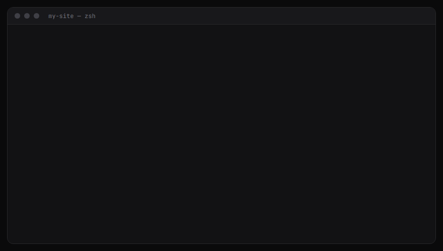

# overflow-audit

**Fail CI when a page scrolls sideways on a phone.** overflow-audit opens each page at phone width in Chromium and checks whether anything sticks out past the screen. If something does, it names the element.



A page that scrolls sideways is the most common mobile layout bug, and it slips through review because desktop screenshots look fine. overflow-audit turns it into a failing check:

```
FAIL http://localhost:3000/pricing @360 overflow=16px offenders=[div.plan-card@375]
```

```bash
npm install -D overflow-audit playwright && npx playwright install chromium
```

## 30-second example

```bash
npx overflow-audit --base http://localhost:3000 / /pricing /blog --width 390 --width 360
```

```
OK   http://localhost:3000/ @390
OK   http://localhost:3000/pricing @390
OK   http://localhost:3000/blog @390
OK   http://localhost:3000/ @360
FAIL http://localhost:3000/pricing @360 overflow=16px offenders=[div.plan-card@375]
OK   http://localhost:3000/blog @360
1 of 6 checks failed.
```

Each offender is `tag#id.class@right`: the element, and where its right edge lands in CSS pixels. On a right-to-left page it's `@left` instead, so `nav.drawer@-300` sticks out 300px past the left edge.

## What counts

- **Fails:** the page scrolls sideways by more than 1px (anything less is rounding), or an element sticks out past the right edge of the screen, or past the left edge on a right-to-left page.
- **Named:** up to three of the outermost elements that stick out; their children aren't listed again. Elements inside open shadow roots count too, named after their host, as `my-widget>div.wide@600`. When nothing sticks out but the page still scrolls, as with a long word or URL, the element whose text spills out is named (`body` for text directly inside it). When an element sticks out but the page reports no sideways scroll, because `<html>` or `<body>` clips it, the line leaves out `overflow=` and lists only the offenders.
- **Passes:**
  - content inside a horizontal scroller (`overflow-x: auto`), such as a wide table;
  - content clipped by an `overflow: hidden` container, such as a carousel, or by `contain: paint` or `content-visibility`;
  - `position: fixed` elements, such as a closed off-canvas menu parked off screen, because they can't make the page scroll (unless an ancestor with a transform, filter, `will-change`, `backdrop-filter` or `container-type` makes them scroll with it);
  - shapes drawn outside their `<svg>`, which don't widen the page;
  - content off the left edge of a left-to-right page (or the right edge of a right-to-left one), which can't be scrolled to;
  - anything you choose to ignore.
- **Still fails:** content clipped by `<html>` or `<body>` itself (see below).

## Good to know

- **`overflow-x: hidden` on `<html>` or `<body>` doesn't fix it on phones.** Chrome on Android still widens the page to fit the content, so it shows zoomed out or wobbles sideways, and overflow-audit (which runs Chromium) still fails it. Clip a wrapper element inside `<body>` instead, or fix the element that sticks out.
- **Pages without a viewport meta tag pass.** Without `<meta name="viewport" content="width=device-width, initial-scale=1">`, a phone lays the page out 980px wide and shrinks it to fit, so nothing scrolls sideways. The page will be tiny, though, so add the tag.
- **Paths resolve like links do.** A path starting with `/` replaces the base URL's path, so `/intro` against `--base https://x.com/app` gives `https://x.com/intro`. Leave off the leading slash (`intro`) to get `https://x.com/app/intro`.
- **Git Bash on Windows rewrites paths.** It turns `/pricing` into `C:/Program Files/Git/pricing` before overflow-audit sees it, which is refused as not an http(s) URL. Run `export MSYS_NO_PATHCONV=1` first, or use full URLs.
- **A `--setup` module must not leave timers or sockets open.** overflow-audit exits once its work is done and nothing is left running, so an open interval, server or database connection keeps it from exiting. Close them before your function returns.
- **Off-canvas menus and right-to-left pages are handled.** A closed menu that is `position: fixed` passes, because it can't make the page scroll. One that is `position: absolute` fails, because it can. On a right-to-left page, content past the left edge is what counts.

## Options

| Flag | Default | |
|---|---|---|
| `urls...`, `--file urls.txt` | | Pages to check. A file has one per line, and `#` starts a comment |
| `--base URL` | | Resolves paths like `/pricing` |
| `--width 390` | `390` | Repeat to check several widths |
| `--settle 1500` | `1500` | Milliseconds to wait after load for animations and late layout |
| `--timeout 30000` | `30000` | Milliseconds to wait for a page to start rendering before reporting it as an error. A stalled image or tracker doesn't count: the waits for the load event and for the network to go quiet are each capped at 10 s |
| `--setup ./login.mjs` | | Sign in first (see below) |
| `--screenshots dir` | | Saves a full-page PNG per page and width, named after the path (`pricing@390.png`), with `-2`, `-3` for names that collide. If a screenshot fails, the check still counts and the line notes it |
| `--ignore selector` | | Hides matching elements during the check. Repeatable. `nextjs-portal` and `[data-overflow-audit-ignore]` are always hidden |
| `--json` | | Prints the results as JSON |

**Exit codes:** 0 when everything fits, 1 when a page overflows, and 2 for bad arguments or a page that didn't load (HTTP 400+ or a network error).

## Signed-in pages

`--setup` takes an ES module whose default export signs in. It runs once, and the cookies and storage it leaves behind are reused for every page.

```js
// login.mjs
export default async function (context, { base }) {
  const page = await context.newPage();
  await page.goto(`${base}/sign-in`);
  await page.getByLabel('Email').fill(process.env.TEST_EMAIL);
  await page.getByLabel('Password').fill(process.env.TEST_PASSWORD);
  await page.getByRole('button', { name: 'Sign in' }).click();
  await page.waitForURL(`${base}/dashboard`);
}
```

## GitHub Action

```yaml
- uses: John-E5/overflow-audit@v0
  with:
    base: http://localhost:3000
    urls: |
      /
      /pricing
      /blog
    widths: 390 360
```

- **Versions:** `@v0` follows the latest 0.x release. To pin one, use `@v0.1.0`. Each release of the action installs the CLI released with it.
- **Prerequisites:** start your app before this step, and use Node 22 or later (`actions/setup-node`).
- **Screenshots:** they are uploaded as the `overflow-audit` artifact, even when the check fails. Running the action more than once in a job? Give each run its own `artifact-name`; each gets its own screenshots.
- **Inputs:** `urls` (one per line, `#` starts a comment), `file`, `base`, `widths` (separated by spaces), `settle`, `timeout`, `setup`, `ignore` (one per line), `screenshots` (`true` or `false`), `artifact-name`, and `package` (the npm install spec for the CLI).

## From code

```ts
import { audit } from 'overflow-audit';

const results = await audit({ base: 'http://localhost:3000', urls: ['/', '/pricing'], widths: [390, 360] });
// [{ url, width, ok, overflow, offenders, screenshot?, screenshotError?, error? }, ...]
```

### Menus, dialogs and other interactive states

Some layouts only appear after a click, so no URL can reach them. Open the page yourself with Playwright, get it into that state, then call `measurePage`. It measures the page as it is, without navigating or waiting.

```ts
import { chromium } from 'playwright';
import { measurePage } from 'overflow-audit';

const browser = await chromium.launch();
const context = await browser.newContext({ viewport: { width: 390, height: 844 }, isMobile: true, hasTouch: true });
const page = await context.newPage();
await page.goto('http://localhost:3000/');
await page.getByRole('button', { name: 'Open menu' }).click();

const { ok, overflow, offenders } = await measurePage(page); // optional: { ignore: ['.toast'], timeoutMs }
await browser.close();
```

Use a mobile context, as above, so the page lays out like a phone. `measurePage` uses the same default ignore list as the CLI.

## Requirements

Node 22 or later and Playwright 1.40 or later (a peer dependency, so you choose the version), with Chromium installed.

---

Extracted from [drift-ci](https://github.com/Drift-CI/drift-ci), where it checks all 22 pages of the drift-ci.com app at 390px. MIT licensed.
